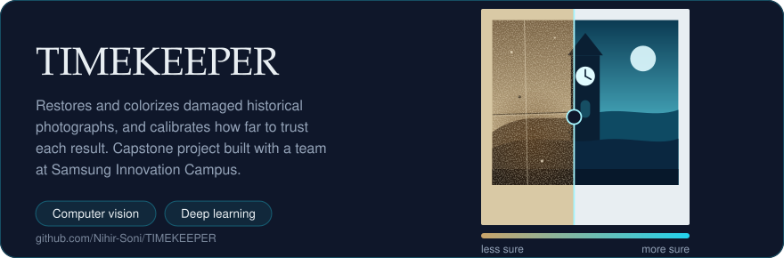
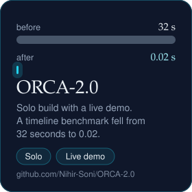
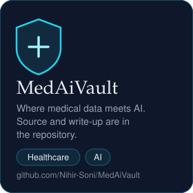
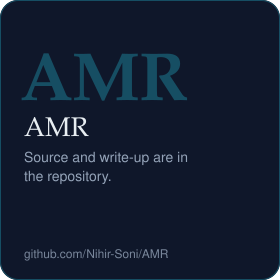
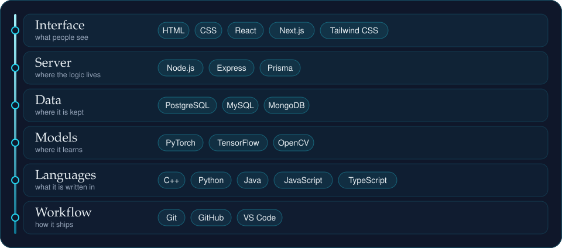
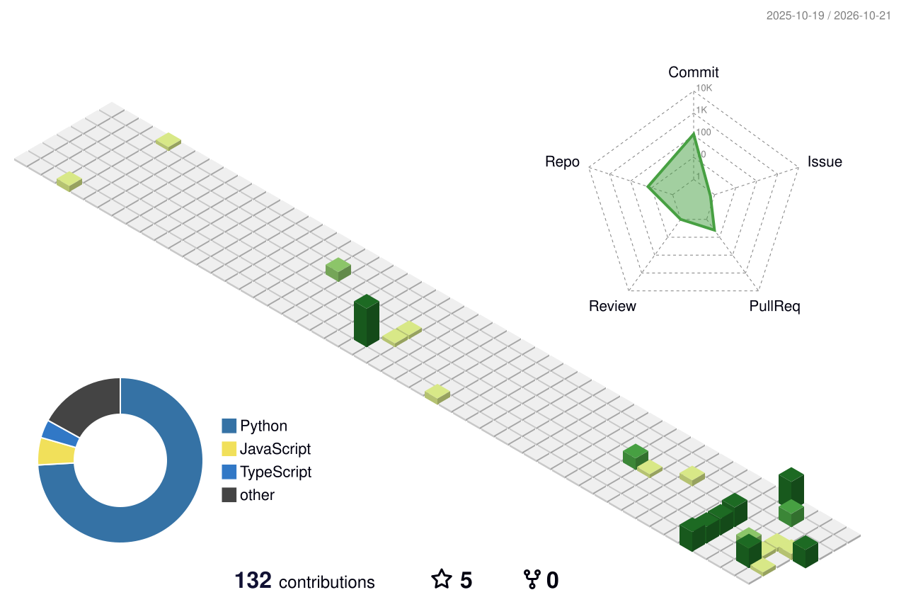

I'm a computer science engineering student who likes taking an idea all the way to something running: the interface, the API, the database and, when it helps, a model behind it.

I'm working with the MERN stack, Next.js and TypeScript, and learning deep learning through computer vision projects. I'm looking for internships in full-stack and backend engineering, and I'm open to AI/ML roles. I also want to contribute to open source.

## Projects

More in the [repositories tab](https://github.com/Nihir-Soni?tab=repositories).

## Stack

## Activity

## Say hello

Open an issue or start a discussion on any repository.

<!-- Add verified LinkedIn, portfolio and email links here when ready. -->
